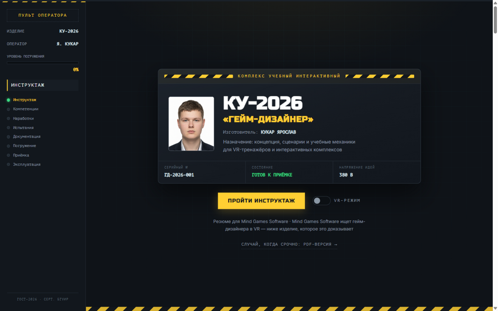
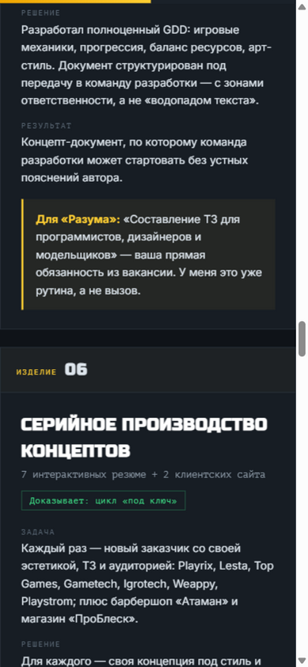

# КУ-2026 «ГЕЙМ-ДИЗАЙНЕР»

Интерактивное резюме гейм-дизайнера для [Mind Games Software (razum.by)](https://razum.by/vacancy) — вместо очередного PDF: **учебный тренажёрный комплекс**, который заказчик сам «принимает в эксплуатацию».

**Живая версия:** https://kerarty.github.io/cv-razum/



## Зачем так

Razum.by делает не развлекательные игры, а **серьёзные игры**: VR-тренажёры и учебные комплексы — центр охраны труда «Минскстроя», динамический тренажёр BELARUS-3522, интерактивные экспозиции МЧС. Значит, резюме должно доказывать не «умею придумывать стрелялки», а **«умею проектировать обучение через игру»**.

Резюме спроектировано как их же продукт — тренажёрный комплекс:

- кандидат — изделие, компания — заказчик, собеседование — приёмочные испытания;
- каждая секция закрывает пункт вакансии и говорит на языке студии (инструктаж по ТБ, уровни погружения, акт ввода в эксплуатацию);
- каждый проект переформулирован в формуле тренажёра: **задача → решение → результат для заказчика**.

## Устройство

| Этап | Раздел | Что закрывает из вакансии |
|---|---|---|
| Шильдик | Техпаспорт изделия | «вау-эффект» с первой секунды |
| 01 | Инструктаж по ТБ | питч: я проектирую обучение |
| 02 | Модули компетенций | 4 уровня погружения (оммаж центру охраны труда) |
| 03 | Наработки сценариев | концепция/сценарий, Unity, playable, GDD |
| 04 | Совместные испытания | «минимум один групповой проект» |
| 05 | Проектная документация | «навыки работы с графикой» — авторские SVG-эскизы |
| 06 | Пробное погружение | играбельный мини-тренажёр проверки знаний |
| 07 | Приёмочные испытания | таблица «требование ↔ доказательство» со штампами «ПРИНЯТО» |
| Финал | Акт ввода в эксплуатацию | контакты, CTA «Хочу к вам гейм-дизом!», PDF |

Пасхалки: VR-тумблер на шильдике, трактор в документации, Konami-код (↑↑↓↓←→←→BA) → аварийная эвакуация к контактам.

## Скриншоты



## Стек

Чистая статика: `index.html` + CSS + vanilla JS, без сборщиков и зависимостей. Контент вынесен в `js/data.js` — тексты правятся без пересборки. Хостинг — GitHub Pages.

## Как открыть локально

Просто открыть `index.html` в браузере, либо:

```bash
python -m http.server 8080
# → http://localhost:8080
```

---
Разработано и произведено Ярославом Кукаром · [github.com/Kerarty](https://github.com/Kerarty) · kukar.yar@gmail.com
